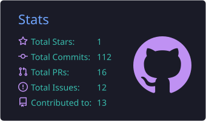
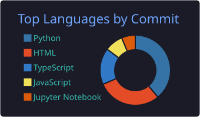

  

  

## 👋 About Me

Hi! I'm a Master's student in Computer Science at the **University of Illinois Urbana-Champaign**.

- I build data platforms and pipelines: Spark, Kafka, Snowflake, and AWS.
- I like replacing scary monoliths with clean, config-driven systems.
- Currently exploring **distributed systems, cloud computing, and applied ML**.
- Fun fact: my code has 0 bugs* *that I know of

## 📫 Connect With Me

  <a href="https://www.linkedin.com/in/bhoomika-n29/"></picture>
  <a href="mailto:bhoomik2@illinois.edu"></picture>

## 🛠️ Technical Skills

**Languages** 
<picture></picture>
<picture></picture>
<picture></picture>
<picture></picture>

**Big Data & Streaming** 
<picture></picture>
<picture></picture>
<picture></picture>
<picture></picture>

**Cloud & DevOps** 
<picture></picture>
<picture></picture>
<picture></picture>
<picture></picture>

**Backend, Databases & ML** 
<picture></picture>
<picture></picture>
<picture></picture>
<picture></picture>
<picture></picture>
<picture></picture>

## 📊 GitHub Stats

  <picture></picture>
  <picture></picture>

<i>"It works on my machine" - me, confidently, every time 🫡</i>

  

